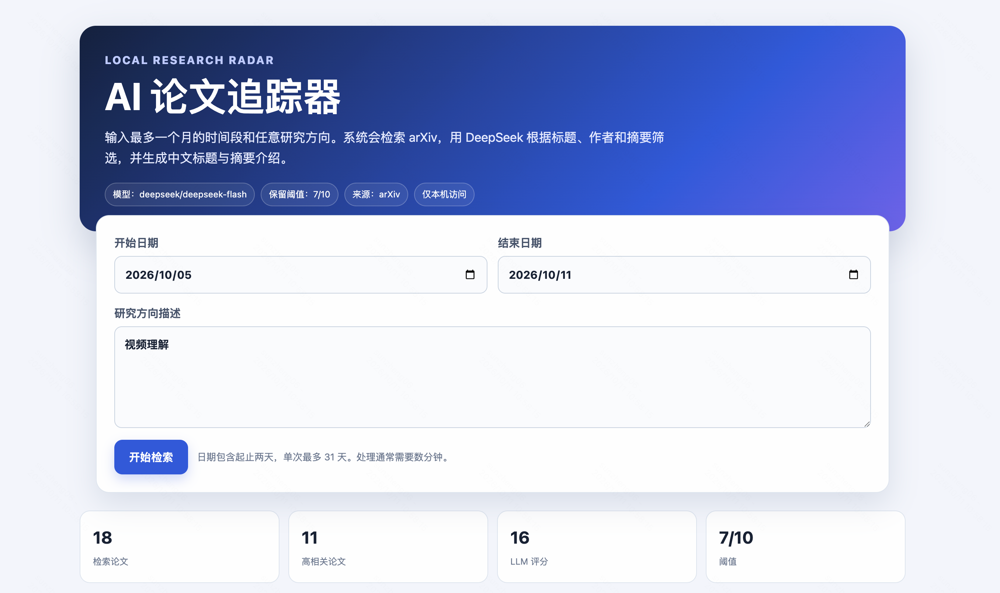
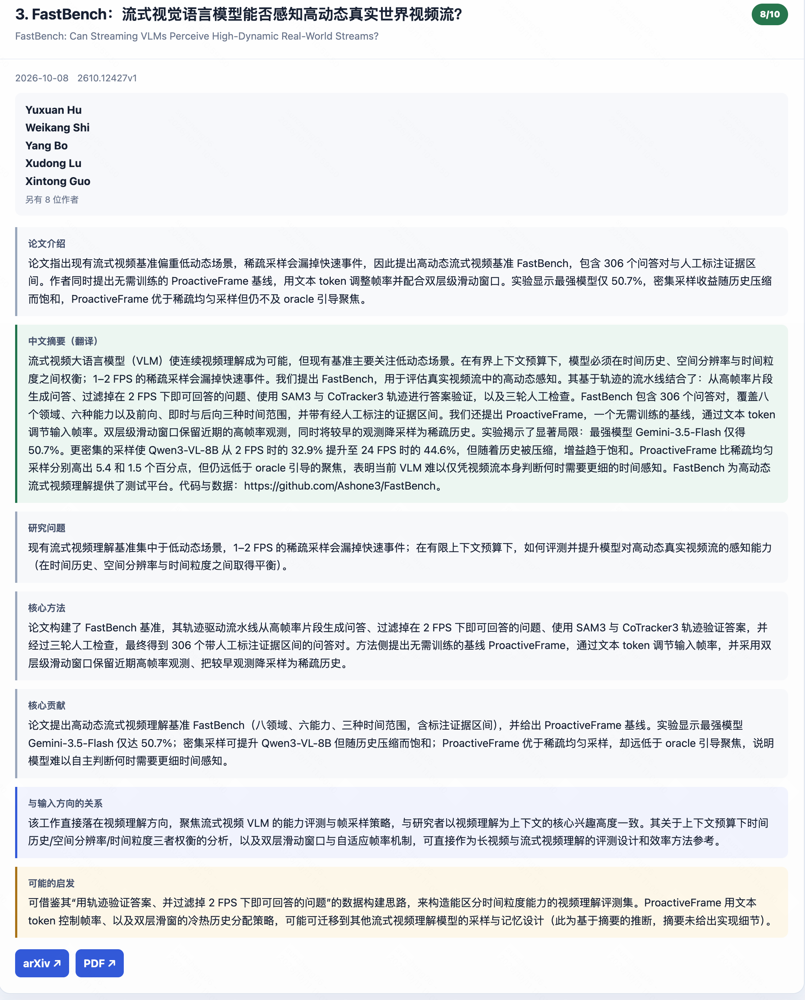

# AI 论文追踪器

一个本地运行的 arXiv 论文检索、相关性评分和中文阅读工具。你可以在网页中输入最多一个月的时间范围和任意研究方向；系统自动生成 arXiv 检索词，抓取论文，只把标题、作者和摘要交给 LLM，最后保留达到评分阈值的论文。

本项目基于 [sunnyw22/arxiv-tldr](https://github.com/sunnyw22/arxiv-tldr) 轻量改造，主要增加了动态研究方向网页、DeepSeek 默认配置、中文摘要翻译、严格阈值过滤以及本地静态报告。

[下载完整代码包 `ai-paper-tracker-v1.0.0.zip`](https://github.com/sz17320828912-tech/ai-paper-tracker/raw/main/ai-paper-tracker-v1.0.0.zip)

## 网页展示

检索首页：选择最长 31 天的日期范围，并输入任意研究方向。



论文详情：展示中英文标题、作者、评分、中文摘要翻译与结构化研究解读。



## 功能

- 浏览器中输入起止日期和任意研究方向，单次最多 31 个自然日
- 以 arXiv 为主要来源，自动生成聚焦的英文检索词
- 使用 DeepSeek 对候选论文进行 1–10 分相关性评分
- `min_score` 可配置；低于阈值的论文不会进入网页结果和最终报告
- 每篇保留论文包含英文标题、中文标题、前几位作者、日期、arXiv 链接、评分、中文摘要翻译、研究问题、核心方法、核心贡献、方向关系和可能启发
- 按相关性评分从高到低排序
- 网页结果支持关键词搜索、评分筛选和详情展开/折叠
- 每次同时生成 Markdown 和可双击打开的静态 HTML 报告
- SQLite 本地缓存，避免重复处理同一论文
- 保留 `daily`、`weekly` 和 `range` 命令行模式

## 数据与隐私边界

每篇论文送给 LLM 的学术内容仅包括：

1. 论文标题
2. 作者姓名
3. arXiv 摘要

用户输入的研究方向会一并提供，用于判断相关性。程序不会下载论文 PDF，也不会把论文正文、分类、链接或本地数据库内容发送给 LLM。论文 ID 只作为批次内结果匹配标识，不参与内容判断。

API Key 从环境变量或本地 `.env` 读取，不写入源码、报告或数据库。`.env`、`api/`、数据库、输出报告和虚拟环境均被 Git 忽略。

## 系统要求

- macOS、Linux 或 Windows（Windows 建议使用 WSL）
- Python 3.11 或更高版本
- 可访问 arXiv 和 DeepSeek API 的网络
- DeepSeek API Key

## 快速开始

```bash
git clone https://github.com/sz17320828912-tech/ai-paper-tracker.git
cd ai-paper-tracker
unzip ai-paper-tracker-v1.0.0.zip
cd ai-paper-tracker-v1.0.0

# 创建虚拟环境、安装依赖并生成本地配置文件
./papers.sh setup

# 编辑 .env，填写：
# DEEPSEEK_API_KEY=你的密钥

./papers.sh web
```

如果已经直接下载并解压了 ZIP，只需进入解压后的 `ai-paper-tracker-v1.0.0` 目录，从 `./papers.sh setup` 开始执行。

网页默认地址：<http://127.0.0.1:8765>

启动脚本只监听 `127.0.0.1`，默认不会对局域网或互联网开放。运行后，在网页中选择日期、填写研究方向并点击“开始检索”。任务完成后，结果直接显示在页面中，并提供 Markdown 与 HTML 报告链接。

如果不想使用安装脚本，也可以手动安装：

```bash
python3 -m venv .venv
source .venv/bin/activate
pip install -r requirements.txt
cp .env.example .env
cp config/config.example.yaml config/config.yaml
```

## 网页检索流程

```text
时间范围 + 研究方向
        ↓
DeepSeek 生成 6–12 个英文 arXiv 检索词
        ↓
arXiv API 按日期检索标题与摘要
        ↓
本地关键词预筛选与去重
        ↓
DeepSeek 阅读标题、作者、摘要并评分
        ↓
丢弃 score < min_score 的论文
        ↓
按分数降序展示，并生成 Markdown + HTML
```

日期校验由前端和后端同时执行：开始日期不能晚于结束日期、结束日期不能晚于当天、区间最多为 31 个自然日。

## 常用命令

```bash
# 首次安装
./papers.sh setup

# 启动本地网页并自动打开浏览器
./papers.sh web

# 启动但不自动打开浏览器
./papers.sh web --no-open

# 增量追踪；首次覆盖最近 7 天，之后从成功检查点继续
./papers.sh daily

# 最近 7 个自然日
./papers.sh weekly

# 指定包含首尾日期的范围
./papers.sh range 2026-09-01 2026-09-30

# 检查 Python、模型、阈值和 API Key 状态
./papers.sh doctor
```

也可以直接使用原项目 CLI：

```bash
.venv/bin/python -m src.cli digest --since 2026-09-01 --until 2026-09-30
```

## 配置

首次执行 `./papers.sh setup` 后会创建 `config/config.yaml`。常用配置如下：

```yaml
summary:
  max_papers: 30
  min_score: 7

llm:
  model: "deepseek/deepseek-flash"
  temperature: 0.2
  max_tokens: 8192
```

网页模式下，研究方向使用本次表单输入，配置文件中的固定研究画像不会覆盖网页输入。`min_score` 仍从配置文件读取。

要切换其他 LiteLLM 支持的服务商，可修改 `llm.model`，并在 `.env` 设置对应环境变量：

```dotenv
DEEPSEEK_API_KEY=
OPENAI_API_KEY=
GEMINI_API_KEY=
ANTHROPIC_API_KEY=
```

## 输出

每次成功运行会在 `output/` 中生成：

```text
output/
├── digest_deepseek-flash_YYYY-MM-DD_HHMM.md
└── digest_deepseek-flash_YYYY-MM-DD_HHMM.html
```

HTML 是完全静态的单文件页面，可直接双击打开，无需启动服务器。报告只包含达到 `min_score` 的论文。

SQLite 缓存默认位于 `data/research_radar.db`。它和报告都不会提交到 Git。

## 结果字段

网页和最终报告为每篇保留论文生成：

- Relevance Score
- 英文标题和中文标题
- 前 5 位作者与作者总数
- arXiv 提供时显示作者单位；没有单位信息时不会让 LLM 猜测
- 发表日期、arXiv 页面和 PDF 链接
- 中文摘要完整翻译
- 研究问题
- 核心方法
- 核心贡献
- 与输入研究方向的关系
- 对研究者可能有启发的地方

## 项目结构

```text
ai-paper-tracker/
├── papers.sh                 # 统一安装与运行入口
├── config/
│   └── config.example.yaml  # 可公开配置模板
├── data/
│   └── schema.sql           # SQLite 表结构
├── src/
│   ├── cli/                 # 命令行入口
│   ├── core/                # 配置、数据模型、密钥加载
│   ├── sources/             # arXiv RSS/API 与可选 INSPIRE
│   ├── ranking/             # 关键词预筛选与 LLM 评分
│   ├── summarization/       # LLM 调用和提示词
│   ├── reports/             # Markdown、HTML、Mattermost
│   ├── storage/             # SQLite 缓存
│   ├── workflows/           # 完整检索流程
│   └── web/                 # Flask 网页与静态前端
└── tests/                   # 自动测试
```

## 开发与测试

```bash
source .venv/bin/activate
pip install -r requirements-dev.txt
ruff check src tests
pytest -q
```

本发布版通过 266 项自动测试，并做过真实 arXiv + DeepSeek 端到端测试。真实调用会产生 DeepSeek API 费用。

## 常见问题

### `API Key：未配置`

确认 `.env` 位于项目根目录并包含：

```dotenv
DEEPSEEK_API_KEY=你的密钥
```

然后运行 `./papers.sh doctor`。不要把真实 Key 写入 `config/config.yaml`、README 或提交到 GitHub。

### arXiv 没有返回论文

缩短或调整研究方向描述，换一个确实有论文发布的日期范围，并确认结束日期不晚于当天。arXiv API 偶尔会限流，稍后重试即可。

### 作者没有单位信息

arXiv Atom API 并不总是提供作者单位。程序只显示来源明确给出的单位，不生成或猜测作者背景。

### 修改端口

```bash
PAPERS_WEB_PORT=9000 ./papers.sh web
```

## 来源与许可说明

本项目是对 [sunnyw22/arxiv-tldr](https://github.com/sunnyw22/arxiv-tldr) 的本地功能扩展。原仓库当前未附带许可证文件，因此此发布包不擅自新增开源许可证；使用、修改或再分发时请同时确认原项目作者的授权条件。
